# StarLost

*"And now, what am I supposed to do?" — [Vento no Litoral, Legião Urbana.](https://www.youtube.com/watch?v=OR1_dmqAoGY)*

A game where your spaceship breaks down and you get stranded on an alien planet.

In this game, you play as an astronaut stranded on an unknown planet. Your spaceship is broken somewhere on the map, and you need to repair it to finally return home.

> [!IMPORTANT]
> **Test my game here:** [Game link](https://hallow303.github.io/Starlost/)
>
> Yes! That's an order!

  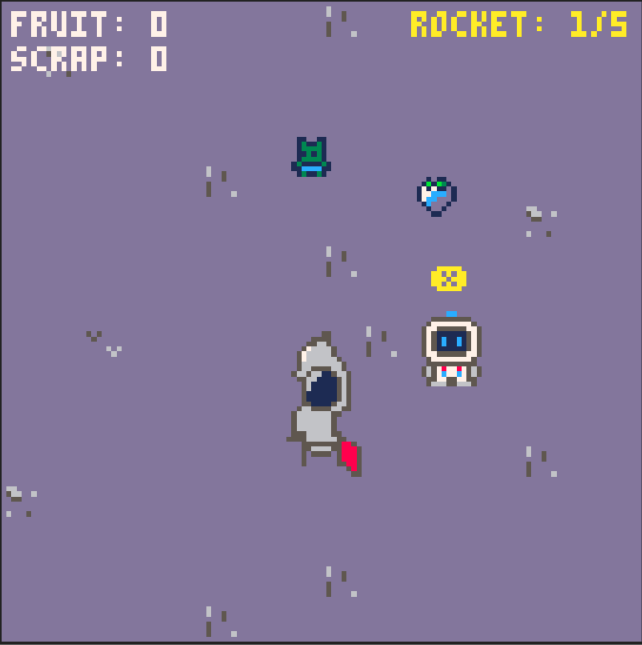

Sounds simple, right? Because it is! 🫠

## Features

The game has a few mechanics to make your gameplay interesting. There aren't many for now, but that's a start!

### 1. Movement

Yes! Moving is important. How many steps have you taken today?

You can use **WASD** or the **arrow keys** to move around the planet.

  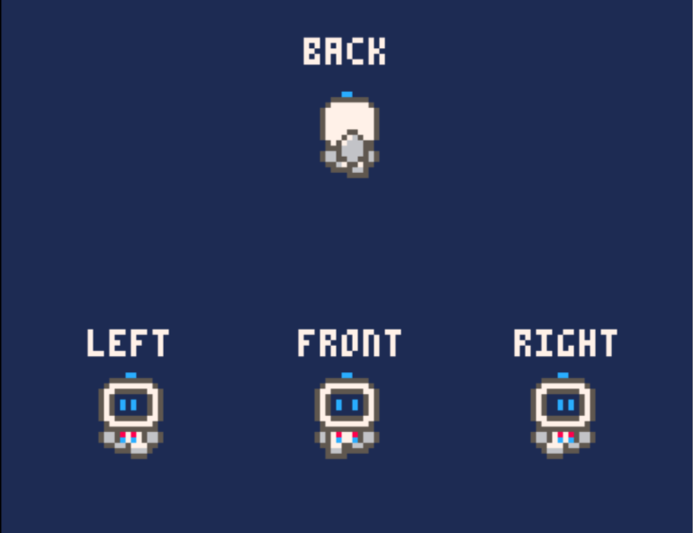
  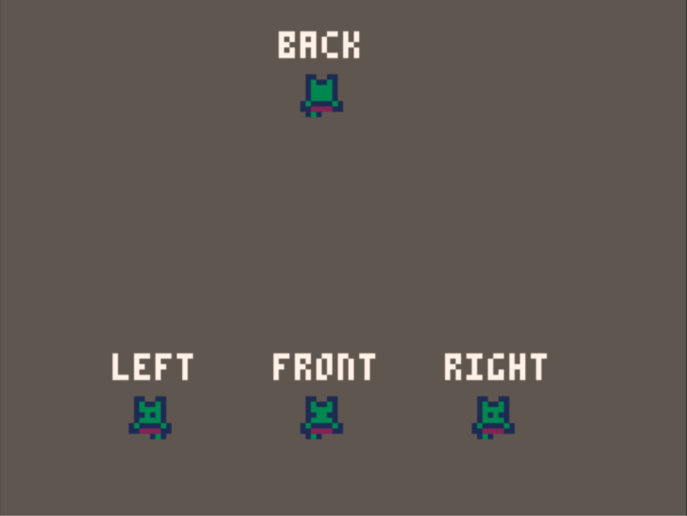

### 2. Fruit Collection

There are fruits scattered around the map, and you need to collect them!

  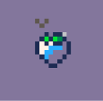

### 3. Trading

You can trade your fruits for scrap with NPCs.

Press **X** to interact with them.

Each piece of scrap costs **3 fruits**.

  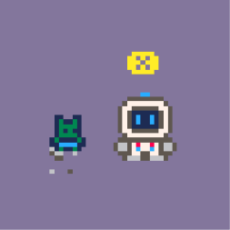

### 4. Repair Your Rocket

  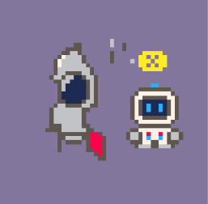

You can repair your spaceship using scrap.

There are **5 repair stages**:

| Stage | Scrap required |
|:---:|---:|
| 1 | 2 |
| 2 | 1 |
| 3 | 2 |
| 4 | 1 |
| 5 | Repaired! |

  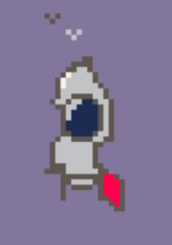
  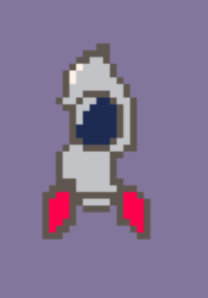
  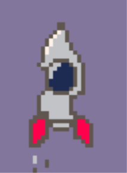
  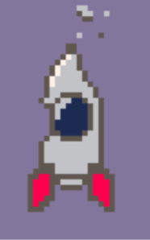
  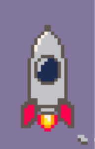

You need **6 pieces of scrap** in total to repair your rocket.

Since each piece costs 3 fruits, you'll need **18 fruits** to complete your mission.

That's a lot of fruit, hehe.

## Start and Ending Screens

Yes! The game has a start screen and an ending screen. They're simple, but hey, they're there!

Here they are:

  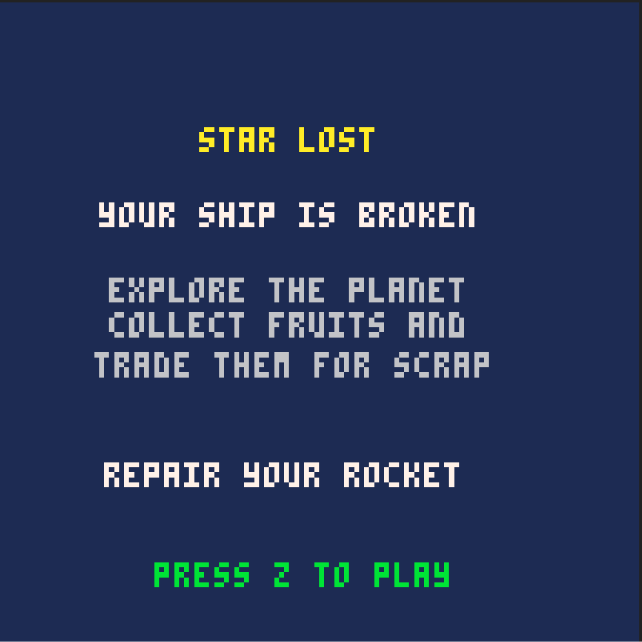
  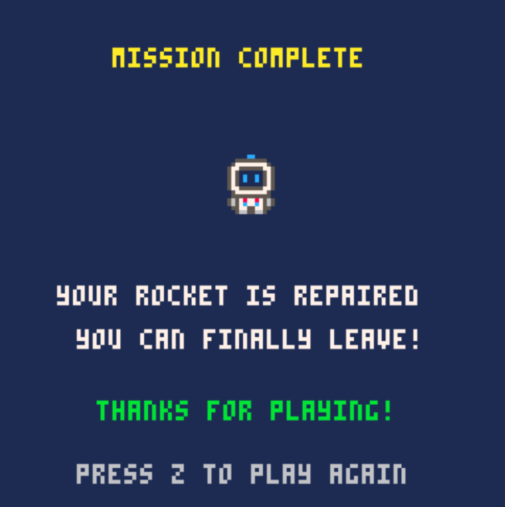

